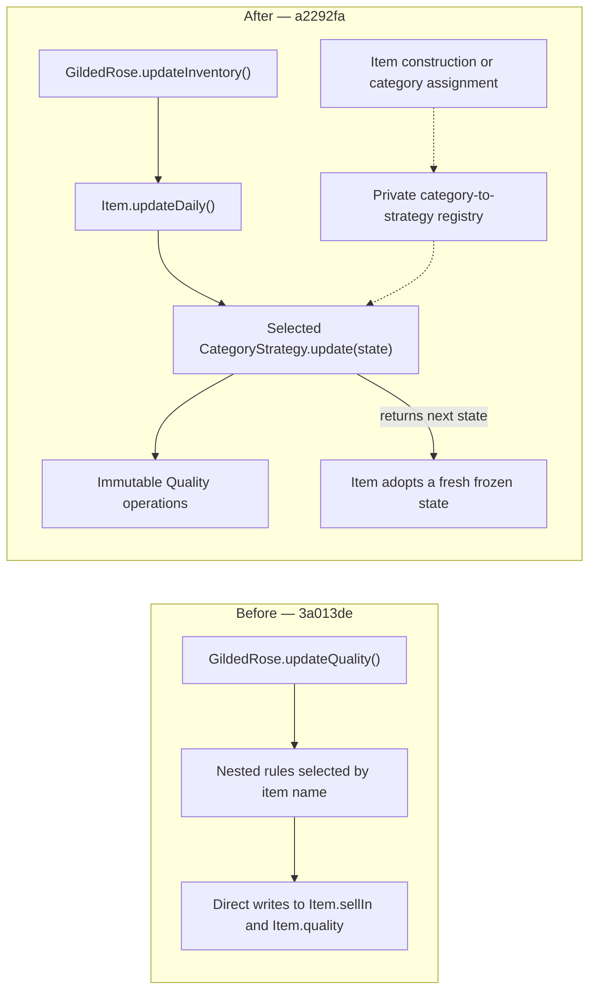

# Changelog

## October 9, 2026 — Explicit category policies and protected item state

Author: Guilherme Ledes. This entry covers all 41 commits from `bdb6e07` to
`a2292fa`, compared with the original project at `3a013de`.

### Summary

The original inventory update combines category selection, quality arithmetic,
expiration rules, and direct item mutation in one nested method. Adding Conjured
would require extending that same method.

The implementation now gives each category its own daily policy. GildedRose
coordinates the inventory, Item owns its state and delegates daily evolution,
and immutable Quality values enforce directional quality limits. Conjured is
implemented alongside the four existing policies.

This work changes the public API and category selection. It preserves the
existing daily rules for integer inputs when the corresponding category is
selected; it does not preserve every original calling pattern.

### Before and after



The solid arrows describe daily evolution. The dashed arrows describe strategy
selection during construction or category assignment, outside the daily call.
Strategies calculate the next state; Item retains ownership of the state it
adopts. The table below also summarizes the diagram for Markdown viewers without
Mermaid support.

| Concern | Before | After |
| --- | --- | --- |
| Classification | Exact commercial name selects special rules | Explicit category; omitted category is Regular |
| Inventory | Owns the nested daily algorithm | Calls `updateDaily()` on each Item |
| Item | Public writable data | Owns protected state and the selected strategy |
| Quality | Arithmetic repeated inside the inventory method | Immutable value with increase, decrease, and reset operations |
| Category policies | Interleaved conditionals | Five stateless strategies and a typed exhaustive registry |
| Tests | Framework-specific folders | Active Vitest specs beside the modules they exercise |

### Changes and rationale

#### Separate daily policies from inventory coordination

Move behavior closer to its data, extract cohesive methods, simplify nested
conditionals with early returns, remove dead code, and name category identifiers
and rule thresholds. These steps make the existing behavior easier to inspect
before extracting the policies.

Characterize expiration, concert windows, quality limits, and inventory identity
before migrating one category at a time. A temporary adapter supports that
transition and is removed once the policies are extracted. Each strategy now
calculates the complete day from the starting state.

| Category | Daily quality rule | Daily deadline rule |
| --- | --- | --- |
| Regular | Lose 1 before expiration; lose 2 at starting `sellIn <= 0` | Decrease by 1 |
| Ages | Gain 1 before expiration; gain 2 at starting `sellIn <= 0` | Decrease by 1 |
| BackstagePasses | Gain 1 above 10 days, 2 at 6–10, or 3 at 1–5; reset to 0 at starting `sellIn <= 0` | Decrease by 1 |
| Legendary | Preserve the supplied quality | Preserve the supplied deadline |
| Conjured | Lose 2 before expiration; lose 4 at starting `sellIn <= 0` | Decrease by 1 |

Quality increases saturate at 50 and decreases saturate at 0 when the operation
starts within the corresponding directional guard. Construction preserves the
supplied number: it does not normalize invalid initial values. For example,
increasing quality 80 leaves it at 80, and decreasing quality -1 leaves it at -1.
Legendary preserves its initial quality, rather than forcing it to 80.

#### Make classification explicit and implement Conjured

Category is independent of the commercial name. The optional fourth constructor
argument defaults to Regular, and `CATEGORY.CONJURED` selects the new policy.
The original three-argument construction remains syntactically available, but
special names no longer select special rules.

Item selects its strategy when constructed and when its category changes.
Changing category leaves quality and deadline untouched until the next update.
Reading category uses the selected strategy's identifier, avoiding a second
classification field that could drift from the behavior.

The private registry uses `Record<Category, CategoryStrategy>` to associate every
typed category with a strategy. Strategies share no mutable item state, so two
items using the same category evolve independently.

#### Protect state and separate domain responsibilities

Extract Item, category identifiers, Quality, strategies, their contract, and the
registry into domain modules. GildedRose retains inventory coordination.

Quality centralizes immutable increase, decrease, and reset operations. Item
uses ECMAScript private fields and owns a frozen daily state record. After a
strategy returns, Item copies the result into a fresh frozen record while
sharing immutable Quality values. It does not freeze the strategy's returned
record. The Legendary strategy returns its input state unchanged; Item still
adopts its own fresh record.

Freeze category identifiers, expose strategy identifiers through getters, name
the quality and concert limits, and make constructor types explicit. The
TypeScript target remains ES2016.

#### Place tests beside their responsibilities

Move the active Vitest tests to `app/**/*.spec.ts`. Strategy tests cover daily
policies directly with real Quality values; Item tests cover construction,
selection, state ownership, and daily collaboration; inventory tests cover
coordination and integration.

Use individual Given/When/Then scenarios with fresh state and real objects.
Protect expiration boundaries, concert windows, quality limits, successive
days, category changes, independent items, and preserved inventory and item
references. The first commit also corrects the original Regular test that used
`sellIn = 0` while expecting the unexpired loss of 1.

The lockfile also changes, including dependency metadata and transitive package
entries. `package.json` remains unchanged. The first commit does not record the
reason for the lockfile changes.

### Breaking changes and migration

#### Inventory method and imports

`GildedRose.updateQuality()` is replaced by `updateInventory()`. Item is no
longer exported from `app/gilded-rose.ts`; import it from its domain module.

Before, using imports relative to the repository root:

```ts
import { GildedRose, Item } from './app/gilded-rose';

const aged = new Item('Aged Brie', 5, 20);
const inventory = new GildedRose([aged]);

inventory.updateQuality();
// aged.sellIn === 4; aged.quality === 21
```

After:

```ts
import { GildedRose } from './app/gilded-rose';
import { Item } from './app/domain/item';
import { CATEGORY } from './app/domain/category';

const aged = new Item('Aged Brie', 5, 20, CATEGORY.AGES);
const conjured = new Item('Conjured Mana Cake', 5, 10, CATEGORY.CONJURED);
const inventory = new GildedRose([aged, conjured]);

inventory.updateInventory();
// aged.sellIn === 4; aged.quality === 21
// conjured.sellIn === 4; conjured.quality === 8
```

#### Explicit categories replace classification by name

Supply `CATEGORY.AGES`, `CATEGORY.BACKSTAGE_PASSES`, or `CATEGORY.LEGENDARY`
where special names previously selected the behavior. Without a category,
`new Item('Aged Brie', 5, 20)` now loses quality as Regular and finishes at 19.
Renaming an item no longer changes its policy. Assigning `item.category` changes
the policy for the next day.

#### Item instances and writable state

Plain objects such as `{ name, sellIn, quality }` no longer satisfy inventory
updates: coordination calls `item.updateDaily()`. Construct real Item instances
instead. Quality and deadline are now getters without setters; external
assignments cannot update them. Name remains writable, and category has a
setter. Consumers that require direct quality or deadline editing need an
explicit migration decision; the current API provides no setters for those
values.

#### Reflection, serialization, and TypeScript inputs

Private state and prototype getters change the enumerable object shape.
`Object.keys`, object spread, and default JSON serialization no longer expose
quality and deadline as original own properties. Category is also a getter.
Build an explicit snapshot when those values are needed:

```ts
const snapshot = {
  name: aged.name,
  sellIn: aged.sellIn,
  quality: aged.quality,
  category: aged.category,
};
```

Constructor arguments now have explicit types: Item takes a string name,
numeric deadline and quality, and an optional Category; GildedRose takes
`Item[]`. Calls previously permitted by implicit `any` may fail TypeScript
checks. These types do not add runtime validation.

#### Fractional inputs have observable differences

The original method checks expiration after decrementing the deadline; the new
policies check the deadline at the start of the day. These approaches agree for
integer deadlines but differ for positive fractions below 1. Quality operations
also clamp fractional transitions to their limits.

| Category and initial state | Original final state | Current final state |
| --- | --- | --- |
| Regular, `sellIn = 0.5`, `quality = 10` | `sellIn = -0.5`, `quality = 8` | `sellIn = -0.5`, `quality = 9` |
| BackstagePasses, `sellIn = 0.5`, `quality = 20` | `sellIn = -0.5`, `quality = 0` | `sellIn = -0.5`, `quality = 23` |
| Regular, `sellIn = 5`, `quality = 0.5` | `sellIn = 4`, `quality = -0.5` | `sellIn = 4`, `quality = 0` |
| Ages, `sellIn = 5`, `quality = 49.5` | `sellIn = 4`, `quality = 50.5` | `sellIn = 4`, `quality = 50` |

The README does not define a fractional deadline policy. These differences are
recorded here rather than hidden behind a claim of complete compatibility.

### Validation and known limits

| Evidence | Result | Source |
| --- | --- | --- |
| Active Vitest suite | 95 tests passed across 9 files | Executed during this review with `./node_modules/.bin/vitest run --coverage.enabled=false` |
| Coverage | 100% statements, branches, functions, and lines | Recorded in commit `2596b1a`; coverage was not measured again during this review |
| TypeScript | Application and active Vitest tests passed with ES2016 | Recorded in the final commits using an external configuration; this is not a global project typecheck |
| Whitespace | Baseline-relative check passed | `git diff --check 3a013de a2292fa`, executed during this review |
| Legendary identity | Direct tests protect return of the same input state | Commit `a2292fa` records 7 passing Legendary tests; total remains 95 |

Later commits record incremental test growth, red/green checks, and temporary
mutations that confirm selected tests detect regressions. The first eight
commits have no validation recorded in their bodies.

Jest and Mocha suites remain outside the active validation scope. They still
call the removed `updateQuality()` method and use plain objects. The README
still advertises those runners; this entry does not claim they pass or that the
global TypeScript check passes.

State ownership safeguards were reviewed in the implementation. Tests using
real strategies do not independently prove resistance to future strategies
that retain aliases or attempt mutation. No performance improvement is claimed.

### Commit history

All entries below are authored by Guilherme Ledes on October 9, 2026, and retain
their original subjects. The groups follow chronological order.

#### Move behavior closer to data and simplify the legacy implementation

- `bdb6e07` — refactor: move behavior closer to its data
- `78bd7af` — refactor: extract cohesive methods
- `f08c900` — refactor: return early clauses
- `13948d3` — refactor: remove dead code
- `99ffdb6` — refactor: replace magic strings
- `e4e3851` — refactor: move statement to parent
- `0e1e361` — refactor: rename to a meaninful function
- `cc731a6` — refactor: return early clauses

#### Establish default classification and characterize existing behavior

- `2d7d121` — refactor: default item category to regular
- `8c8c655` — test: characterize expired regular items
- `bc0ccb4` — test: characterize expired regular quality floor
- `5d9068c` — test: characterize aged quality boundaries
- `d077ae4` — test: characterize backstage deadline boundaries
- `acb6574` — test: characterize remaining category boundaries
- `c1512f1` — test: characterize inventory contracts

#### Encapsulate state, extract policies, and add Conjured

- `7af6c03` — refactor: encapsulate item state changes
- `a7dba1d` — refactor: introduce category strategy dispatch
- `bdccea0` — refactor: extract regular category strategy
- `1df0dc7` — refactor: extract aged category strategy
- `65b6edd` — refactor: extract backstage passes category strategy
- `f681b96` — refactor: extract legendary category strategy
- `2ca8335` — refactor: remove legacy item update rules
- `799ee83` — feat: support conjured items

#### Separate modules and clarify limits, privacy, and types

- `cca4d57` — refactor: extract item and category domain modules
- `f93bceb` — refactor: extract category strategy modules
- `9076dab` — refactor: extract category strategy registry
- `47171d6` — refactor: name item quality limits
- `5858a41` — refactor: name backstage concert thresholds
- `b765e06` — refactor: enforce item state privacy at runtime
- `3863c3a` — refactor: make constructor types explicit

#### Colocate tests with the behavior they protect

- `9466219` — test(strategies): colocate daily policy scenarios
- `f9ee31a` — test(gilded-rose): colocate inventory integration scenarios
- `a1049f6` — test(item): colocate entity scenarios and finalize discovery

#### Complete immutable daily evolution and direct strategy collaboration

- `d173665` — refactor(item): centralize directional quality rules
- `a00c02b` — refactor(item): encapsulate daily evolution by category
- `1a1ecc7` — refactor(strategies): colocate category definitions with registry
- `c7465b7` — refactor(item): protect daily state ownership
- `0602f75` — refactor(category): encapsulate daily strategy selection
- `2596b1a` — refactor(item): delegate daily evolution to selected strategy
- `03d02f5` — style(category): remove trailing blank line
- `a2292fa` — test(legendary): assert daily state reference preservation
